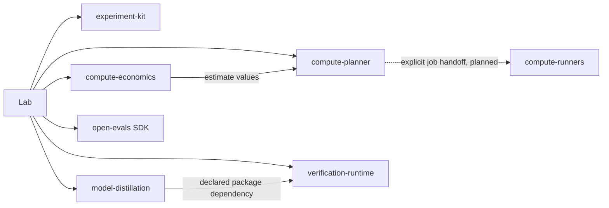

# Ecosystem architecture

Last updated: 2026-11-10

Lab assembles seventeen component products and the existing Open Evals platform.
Five component libraries are implemented: experiment-kit, compute-economics,
compute-planner, model-distillation and verification-runtime. The other twelve component homes are
planned. The SDK is packaged inside open-evals and is not another repository.

## Executable composition

The current Lab 0.4 CPU fixture workflow validates a common research record,
constructs a preference pair from authored responses, calculates a hypothetical
GPU-training estimate, and orders/recommends work through the planner. SDK
evidence delivery is an explicit optional application operation.

The process itself runs on CPU. Its estimate uses authored model/token/resource/
price assumptions and is labelled `observed_billing: false`. The economics
formula does not measure the CPU process, a GPU training run, or an invoice.
No runner, model trainer, serving engine or research-controller engine is
implemented by this integration fixture.

The arrow from economics to planning is a value handoff, not a required package
import. A caller can substitute another estimate or an explicit assumption.
The base, verification, economics, planning, compute, distillation and evals installation
selectors keep these dependencies independently selectable.

## Verification and planned product composition

Verification-runtime owns headless objective checks. Exact-match v1 is implemented;
code sandbox, math, schema, environment and citation adapters remain planned.
Distillation consumes the result and separately enforces teacher eligibility and
binds subject/candidate/reference identities. Open Evals retains scoring and gates.

Model-architectures owns model math/configuration, forward/generation/cache and
weight compatibility; trainers own optimization, data iteration and resume.
Research-artifacts will materialize/cache/verify bytes through existing storage
backends. Domain schemas, model compatibility and promotion keep their own owners.

- Model-data owns datasets/splits/manifests and may encode/pack using an explicit
  tokenizer artifact. Model-tokenizers owns tokenizer fitting, inspection,
  comparison and vocabulary/normalization policy.
- Model-pretraining owns base and continued pretraining. Model-posttraining
  accepts an independently supplied base model and owns SFT, preferences and
  reward-based model adaptation. Model-distillation owns permitted synthetic/
  preference-data construction, not the student's optimizer.
- Model-serving accepts compatible model artifacts and owns endpoint lifecycle.
  Inference-benchmarks can measure any compatible external endpoint without
  installing that serving toolkit.
- Research-controller owns reusable bounded model-research sequencing, candidate
  state, limits and promotion policy. It consumes training/evaluation adapters.
  Lab owns demonstrations and study-specific configurations. Open Evals owns
  evaluation and system-prompt improvement; it is not replaced by the controller.
- RL environments own task dynamics/rewards; training algorithms consume their
  contracts. ML foundations owns educational implementations/comparisons.

These planned boundaries are intended independently usable products. The
specifications do not establish working engines or real model results.

## Interfaces and release direction

Components expose native APIs or explicit artifact/job interfaces and never
depend on Lab. There is no mandatory shared Python object model across every
product. Package dependencies, endpoint bindings, artifact hashes and versioned
evaluation results are the composition seams.

[Interface ownership](references/interfaces.md) defines those handoffs and the
costing API move. [Canonical ownership](references/component-ownership.md)
assigns each current capability once. Selected source revisions and review
state live in [the composition manifest](../src/lab/composition.json).

Existing-repository scope changes remain review branches until accepted.
Repository identities/history survive the model-training to model-pretraining
and model-inference to model-serving renames. New product homes have their own
main branches and independent release ownership.

## Artifacts, history and recovery

Object storage remains canonical for large datasets, tokenizer/model artifacts,
checkpoints and evaluation outputs; local disks and provider filesystems are
caches or execution optimizations. Preserve exact source revisions, hashes,
parent lineage, licenses and observed measurement coverage. Unknown cost/time/
memory is not a measured zero.

The [first inventory](sources/repository-split-map.json) freezes the original
57-file migration. The [expansion aliases](sources/expanded-repository-aliases.json)
and [current recovery map](sources/repository-split-v3-map.json) carry the next
routing step through pinned component relocation records. Do not rewrite
first-stage source snapshots or receipts to make their old names look current.

Use [the recovery procedure](runbooks/recovered-laptop.md) for later laptop work.
Current expanded installation evidence is in the
[expanded receipt](results/2026/11-10/product-installed-package.json); earlier
source and installation results retain their historical scope.
