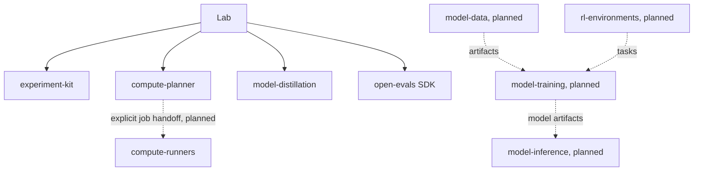

# Ecosystem architecture

Last updated: 2026-11-10

Lab assembles components; no component depends on Lab. A user can install the
implemented libraries separately or combine selected versions.

Current executable composition is a CPU fixture workflow: validate a common
record, order candidate jobs, recommend providers, verify supplied fixture
responses, and construct a preference pair. Optional SDK delivery transmits
evidence from that execution. It does not run an Open Evals evaluation.

Future data/training/inference workflows are documented interfaces, not engines
implemented by this split. Classical ML implementations belong in ml-foundations.
RL environments own tasks/dynamics; model-training owns RL training algorithms.

## Interfaces

Experiment-kit owns common metadata and the separate legacy LLM validator.
Other components expose their native APIs and may accept explicit records or
artifact references; they do not need a mandatory central Python object model.
Compute-planner owns estimates and scheduling policy. Compute-runners will own
submit/status/cancel/logs and execution receipts. Planning is not authorization
to allocate resources. Model-inference owns endpoint lifecycle.

Each repository declares only its own dependencies. Compatible combinations
are pinned in [the composition manifest](../src/lab/composition.json).
No sibling imports, copied implementation facades, submodules, or global
multi-repository lockfile are required.

## Artifacts and provenance

Object storage remains canonical for large datasets, tokenizers, checkpoints,
and evaluation outputs. Local/parallel filesystems are caches or execution
optimizations. Record source revisions and content hashes; never keep the only
copy on a provider-specific machine. Integrated experiment configs remain in
Lab; their referenced artifacts need independent materialization.

The [ownership map](references/component-ownership.md) routes future work.
The [migration inventory](sources/repository-split-map.json) records every
original tracked file, its source hash, and destination. Historical design is
preserved byte-for-byte in [pre-split sources](sources/README.md) and original
Git history. The original local checkout and open documentation PR are retained.
